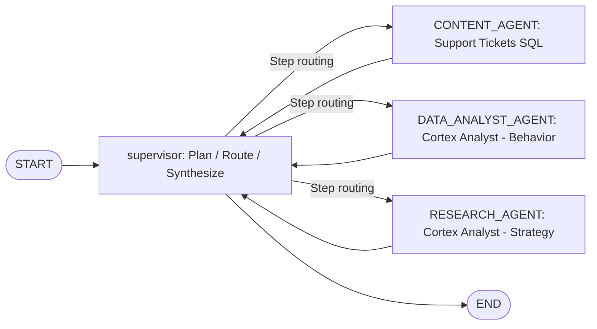

# Multi-Agent Customer Intelligence with Snowflake & LangGraph

**One-Page Executive Summary & Demo Talk Track**

---

## 1. Executive Summary

We built and deployed a live **multi-agent customer intelligence system** orchestrating **LangGraph** (`studio_app.py`) over **Snowflake** (trial account, `SNOWFLAKE_LEARNING_WH`), running locally via `langgraph dev` (`http://127.0.0.1:2024`) with **LangSmith Studio** visual tracing and debugging.

### Live Snowflake Assets (`CUSTOMER_INTELLIGENCE_DB.PUBLIC`)
- **4 Core Tables Loaded**:
  - `CUSTOMERS` (`10,000` rows)
  - `USAGE_EVENTS` (`508,637` rows covering `9,990` of the `10,000` customers; `10` signed up too recently to have usage; backfilled from `101,711` on 2026-11-17 with `python data_generation.py --backfill-usage`, which only inserted rows so ticket, churn, and revenue numbers did not change)
  - `SUPPORT_TICKETS` (`8,954` rows)
  - `CHURN_EVENTS` (`703` rows)
- **2 Semantic Views** (`sql/03_setup_semantic_views.sql`):
  - `CUSTOMER_BEHAVIOR_ANALYST` (usage, engagement, satisfaction, churn)
  - `STRATEGIC_RESEARCH_ANALYST` (MRR, customer lifetime, industry segmentation, lost revenue)
- **3 Cortex Agent Definitions** (`SNOWFLAKE_INTELLIGENCE.AGENTS` via `sql/05_setup_cortex_agents.sql`):
  - `CONTENT_AGENT`, `DATA_ANALYST_AGENT`, `RESEARCH_AGENT`

### Multi-Agent Architecture (`supervisor_workflow`)



- **`DATA_ANALYST_AGENT` & `RESEARCH_AGENT`**: Call Snowflake's live **Cortex Analyst REST API** (`/api/v2/cortex/analyst/message`) against `CUSTOMER_BEHAVIOR_ANALYST` and `STRATEGIC_RESEARCH_ANALYST`, then execute the generated `SEMANTIC_VIEW(...)` SQL directly on Snowflake.
- **`CONTENT_AGENT`**: Executes parameterized Snowflake SQL against `SUPPORT_TICKETS` for keyword/customer matching, CSAT averages, priority counts, and category breakdowns.
- **`supervisor_node`**: Creates a structured multi-step plan with a deterministic Python planner (term matching, no LLM; unmatched questions fall back to `DATA_ANALYST_AGENT` and are tagged `planner_fallback`), routes dynamically via LangGraph `Command(goto=...)`, propagates context across steps, and synthesizes a final executive markdown brief.

### Structural & Trial-Org Insights
- **Trial-Org Adaptation**: Unpaid Snowflake trial accounts restrict `AI_COMPLETE`, `AI_EMBED`/`EMBED_TEXT_*` (Cortex Search), Cortex Inference (`403`), and the Cortex Agent `:run` endpoint (`399504`), while new accounts also block legacy `SNOWFLAKE.CORTEX.COMPLETE` (`399270`). Because **Semantic Views and Cortex Analyst REST text-to-SQL run natively on trial accounts**, the app pairs live Cortex Analyst + parameterized SQL today—while keeping `SNOWFLAKE_USE_CORTEX_AGENTS=true` as the upgrade path for full Cortex accounts (after `sql/02` and `sql/04` succeed; untested on the trial org).
- **Dual Observability Stack (`LangSmith` + `Snowflake` + `TruLens`)**:
  - **LangSmith Nested Waterfall**: `@traceable` spans wrap `cortex_analyst_text_to_sql` (`llm`), `snowflake_support_tickets_search` (`retriever`), and `snowflake_sql_execute` (`tool`), logging `sfqid`, Cortex Analyst `request_id`, row counts, SQL latency, and deterministic feedback scores (`execution_success`, `non_empty_results`, `zero_errors`, `step_count`).
  - **Snowflake Telemetry View (`AGENT_OBSERVABILITY_LOGS`)**: Every SQL query emits a structured JSON `QUERY_TAG` (`app`, `trace_id`, `agent`, `step`, `tool`), queried live via `CUSTOMER_INTELLIGENCE_DB.PUBLIC.AGENT_OBSERVABILITY_LOGS` (`sql/06_setup_observability_view.sql`) for two-way trace ↔ Snowsight correlation.
  - **LangSmith Evaluation & TruLens OTEL**: `evaluate_observability.py` runs `langsmith.evaluate(...)` across a 12-example dataset (`route_match`, `sql_executed_with_rows`, `eval_zero_errors`) plus `TruGraph` (`trulens-apps-langgraph`) OTEL recording (enabled by pinning `sqlalchemy<2.1`).
- **Modularization**: `studio_app.py` used to mix session/Snowflake logic with supervisor orchestration. It is now split into `supervisor.py`, `snowflake_client.py` and `observability.py`. `data_generation.py` and the notebook still have their own login code.

---

## 2. Demo Talk Track (2–3 Minutes)

Order: show the result first, explain it second, prove it third. The full step-by-step version is in `DEMO_SCRIPT.md`.

### Cold Open — The Hard Question, Live (60 sec)
*(Open cold in Studio, or cue from Slide 2 of `DEMO_DECK.html`. Prompt to run in Studio: `"Find customers complaining about API issues and analyze their churn rate and monthly revenue"`)*
> "Leaders don't ask single-table questions. They ask this." *(paste, submit, let the first node light up)*
> 1. **`CONTENT_AGENT`** searches `SUPPORT_TICKETS` and isolates `502` API-related tickets across `461` customers (`264` `technical_issue`, `238` `integration_help`, average CSAT `3.03`, `132` high or urgent).
> 2. **`DATA_ANALYST_AGENT`** queries `CUSTOMER_BEHAVIOR_ANALYST` via Cortex Analyst and finds `1,452` customers in those ticket categories, `110` churned—a `7.58%` churn rate.
> 3. **`RESEARCH_AGENT`** queries `STRATEGIC_RESEARCH_ANALYST` to quantify financial exposure: `$405.89` average MRR and `$589,348.85` total monthly revenue across those same `1,452` customers (customers who filed `technical_issue` or `integration_help` tickets, not only the `461` who mention the API).
>
> "Three data domains, one executive brief, and the SQL for each step is traceable."

### What You Just Saw — Architecture & the Trade-Off (40 sec)
*(Same Studio canvas, the finished run still highlighted)*
> "This is a hub-and-spoke `StateGraph`: one `supervisor` plans once, routes step by step, and writes the brief. Three specialists share one typed `State` contract and read Snowflake data behind governed `SEMANTIC VIEW` definitions, so Cortex Analyst generates repeatable SQL without guessing joins or KPI definitions. The planner is deterministic Python, not an LLM. That was a deliberate choice: this trial account blocks `AI_COMPLETE`, so the LLM runs only where it earns its cost—text-to-SQL—and routing is repeatable, free, and covered by an offline unit-test suite."

### Proof — Same Run, Two Systems (40 sec)
*(Split screen: LangSmith waterfall on the left, Snowsight chart of `AGENT_OBSERVABILITY_LOGS` for the same trace ID on the right)*
> "Most agent demos stop at the left side. On the right is Snowflake's own query history for the same run: the agent's SQL statements as bars on the right. Every LangSmith SQL span carries the Snowflake query ID, and every SQL statement the agent runs carries a `QUERY_TAG` with the LangSmith trace ID. Text-to-SQL time lives on the LangSmith side, while a platform team can check SQL time and rows per step from inside Snowflake."

### Why a Semantic View — The CLV Story (60 sec)
*(Studio: ask "What is the average customer lifetime value by industry?")*
> "Why a Semantic View? Before I fixed it, this exact question failed in my evaluation. Cortex Analyst refused to guess: customer lifetime value had no governed definition, and it asked which formula I meant. That is the right behavior. So I defined CLV once in Snowflake—final monthly revenue times months active, for churned customers—and both agents now share it. The LLM translates English into SQL, but only over metrics the business has defined. The formula is visible, the answer is repeatable, and the definition sits under Snowflake's governance instead of in a prompt. The eval suite found the gap before a customer did."

### The Trace Caught Bad Behavior (60 sec, optional)
*(Studio: ask "How many urgent API support tickets are there?", then open the LangSmith trace)*
> "This run succeeded, with no errors and rows returned, but the answer is wrong: 729 'urgent API tickets,' and one sample is a password reset. The trace shows why: my ticket search ORs five keywords, and 'urgent' matches a password ticket that says 'need access urgently.' No error alert would fire. The trace is how I found it, and now I can decide the fix: require every keyword, use the priority column, or route it through the Semantic View. My evaluators check routing, SQL and errors. A relevance evaluator is the next one to add."

### Closing — Production Path (20 sec)
> "Everything you saw ran live on a Snowflake trial account. Offline evals in LangSmith (`route_match`, `sql_executed_with_rows`, `eval_zero_errors`) guard every change to a Semantic View or a planner rule. On a full account, running `sql/02` and `sql/04` and setting `SNOWFLAKE_USE_CORTEX_AGENTS=true` swaps in Snowflake-managed Cortex Agents and Cortex Search on the same graph. That mode is written and not yet tested, because the trial blocks it."

---

## 3. Quick Reference Commands & Artifacts

```bash
# Start everything, verify live warmup, open tabs + DEMO_DECK.html, and queue prompts
./start_demo.sh

# Pre-flight verification only (starts server, runs live warmup, shuts down cleanly)
./start_demo.sh --check-only

# Run CLI verification tests
.venv/bin/python studio_app.py

# Run LangSmith eval + TruLens recording + Snowflake audit check
.venv/bin/python evaluate_observability.py

# Start LangGraph dev server + Studio API manually
.venv/bin/langgraph dev --allow-blocking --no-browser
```

- **Companion Slide Deck**: `DEMO_DECK.html` (`open DEMO_DECK.html`)
- **Local API**: `http://127.0.0.1:2024` (`http://127.0.0.1:2024/docs`)
- **LangSmith Studio**: `https://smith.langchain.com/studio/?baseUrl=http://127.0.0.1:2024`
- **Snowflake Audit View**: `SELECT * FROM CUSTOMER_INTELLIGENCE_DB.PUBLIC.AGENT_OBSERVABILITY_LOGS LIMIT 20;`
