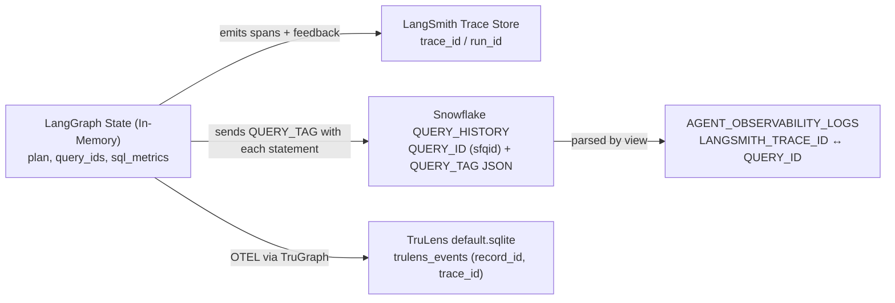

# Observability & Trace Storage Data Model

This project captures execution traces across **four connected layers**: in-memory LangGraph `State`, **LangSmith** (hosted span tree + feedback), **Snowflake** (`AGENT_OBSERVABILITY_LOGS` view over `INFORMATION_SCHEMA.QUERY_HISTORY`), and **TruLens** (`default.sqlite` OpenTelemetry event store).

---

## 1. Cross-Store Correlation Model



| Correlation Key | Emitted By | Stored In | Purpose |
| --- | --- | --- | --- |
| `LANGSMITH_TRACE_ID` (`trace_id`) | `get_current_run_tree()` in `observability.py` | LangSmith root trace, `State` telemetry footer, Snowflake `QUERY_TAG:trace_id` | Joins LangSmith trace waterfall to Snowflake `AGENT_OBSERVABILITY_LOGS` |
| `QUERY_ID` (`sfqid`) | Snowpark `df.collect(block=False).query_id` | LangSmith `snowflake_sql_execute` metadata, `State.query_ids`, Snowflake `QUERY_HISTORY.QUERY_ID` | Links a LangSmith tool span directly to a Snowsight Query Profile |
| `cortex_request_id` | Cortex Analyst REST response (`request_id` / `x-snowflake-request-id`) | LangSmith `cortex_analyst_text_to_sql` span metadata | Traces text-to-SQL generation inside Snowflake Cortex Analyst |
| `ai.observability.record_id` | `TruGraph` OTEL wrapper (`evaluate_observability.py`) | `trulens_events.record_attributes`, `trulens_records.record_id`, `trulens_feedbacks.record_id` | Groups all OTEL spans and feedback scores for a single TruLens run |

---

## 2. In-Memory Execution State (`State` in `supervisor.py`)

`State(MessagesState)` carries both workflow routing state and accumulated SQL telemetry across graph hops:

| Field | Type | Purpose |
| --- | --- | --- |
| `messages` | `List[BaseMessage]` | Inherited from `MessagesState`; holds user prompt, agent `AIMessage`s, and final synthesized response |
| `plan` | `Optional[Dict]` | Immutable plan created once by `supervisor_node` (`plan_summary`, `total_steps`, `steps[]`) |
| `current_step` | `int` | Zero-based index into `plan["steps"]` |
| `agent_outputs` | `Dict` | Keyed by agent name (`CONTENT_AGENT`, `DATA_ANALYST_AGENT`, `RESEARCH_AGENT`) |
| `execution_errors` | `List` | Aggregated error strings captured without crashing the graph |
| `planning_complete` | `bool` | Locks the plan after initial planning |
| `query_ids` | `List[str]` | Ordered list of Snowflake `sfqid`s executed during the run |
| `sql_metrics` | `List[Dict[str, Any]]` | Per-query records (`agent`, `tool`, `sfqid`, `cortex_request_id`, `analyst_ms`, `sql_ms`, `rows`) |

---

## 3. LangSmith Hosted Trace Model (`observability.py` + `langgraph dev`)

### Span Hierarchy
```text
supervisor_workflow (root graph run)
├── supervisor (planning)
├── CONTENT_AGENT
│   └── snowflake_support_tickets_search (run_type="retriever")
│       ├── snowflake_sql_execute (run_type="tool")  [SUMMARY]
│       ├── snowflake_sql_execute (run_type="tool")  [BREAKDOWN]
│       └── snowflake_sql_execute (run_type="tool")  [SAMPLES]
├── DATA_ANALYST_AGENT
│   └── cortex_analyst_text_to_sql (run_type="llm")
│       └── snowflake_sql_execute (run_type="tool")  [CORTEX_ANALYST_SQL]
├── RESEARCH_AGENT
│   └── cortex_analyst_text_to_sql (run_type="llm")
│       └── snowflake_sql_execute (run_type="tool")  [CORTEX_ANALYST_SQL]
└── supervisor (synthesis + emit_langsmith_feedback)
```

### Span Metadata & Tags
- **`supervisor` span (`annotate_run_tree`)** (not the root run; feedback scores go on the root run):
  - `metadata`: `plan_summary`, `total_steps`, `route`, `intents`, `matched_terms`, `planner_fallback`, `snowflake_query_ids`, `total_sql_rows`, `error_count`
  - `tags`: `trial_mode` (or `cortex_agents_mode`), `route:<AGENT1->AGENT2>`, `intent:<content|analyst|research>`, `planner_fallback` (only when no keyword matched and the planner guessed the data analyst)
  - Find what users ask about: LangSmith filter `has(tags, "intent:content")`.
- **`cortex_analyst_text_to_sql` (`llm`)**:
  - `metadata`: `semantic_view`, `cortex_request_id`, `analyst_latency_ms`, `generated_sql`
  - `tags`: `semantic_view:<VIEW_NAME>`
- **`snowflake_support_tickets_search` (`retriever`)**:
  - `metadata`: `extracted_customer_ids`, `extracted_keywords`, `keyword_fallback`, `matching_tickets`, `customers_affected`
- **`snowflake_sql_execute` (`tool`)**:
  - `metadata`: `snowflake_query_id`, `snowflake_query_tag`, `elapsed_ms`, `row_count`, `warehouse`
  - `tags`: `agent:<AGENT_NAME>`, `tool:<TOOL_NAME>`

### Feedback & Offline Evaluation Keys
- **Online Feedback (`emit_langsmith_feedback` in `observability.py`)**:
  - `execution_success` (`0.0 | 1.0`), `non_empty_results` (`0.0 | 1.0`), `zero_errors` (`0.0 | 1.0`), `step_count` (`float`)
- **Offline Dataset (`SnowLangGraph Customer Intelligence Eval` in `evaluate_observability.py`)**:
  - `route_match`, `sql_executed_with_rows`, `eval_zero_errors`

---

## 4. Snowflake Query Telemetry Model (`AGENT_OBSERVABILITY_LOGS`)

Each query is sent with this QUERY_TAG as a statement parameter (`collect(statement_params={"QUERY_TAG": ...})`). The shared session is never changed, so runs at the same time keep their own tags:

```json
{
  "app": "snowlanggraph",
  "trace_id": "01a1e595-bd96-734e-be48-1c9d97ecf53e",
  "agent": "RESEARCH_AGENT",
  "step": 1,
  "tool": "CORTEX_ANALYST_SQL"
}
```

The view `CUSTOMER_INTELLIGENCE_DB.PUBLIC.AGENT_OBSERVABILITY_LOGS` (`sql/06_setup_observability_view.sql`) queries `TABLE(CUSTOMER_INTELLIGENCE_DB.INFORMATION_SCHEMA.QUERY_HISTORY(RESULT_LIMIT => 10000))`, filters `APP_NAME = 'snowlanggraph'` and `EXECUTION_STATUS != 'RUNNING'`, and exposes:

| Column | Snowflake Type | Source / Meaning |
| --- | --- | --- |
| `QUERY_ID` | `VARCHAR(16777216)` | Snowflake `sfqid` |
| `QUERY_TEXT` | `VARCHAR(16777216)` | Executed SQL text (Cortex Analyst `SEMANTIC_VIEW` SQL or parameterized ticket SQL) |
| `QUERY_TAG` | `VARCHAR(16777216)` | Raw JSON tag string |
| `APP_NAME` | `VARCHAR(16777216)` | `TRY_PARSE_JSON(QUERY_TAG):app::STRING` |
| `LANGSMITH_TRACE_ID` | `VARCHAR(16777216)` | `TRY_PARSE_JSON(QUERY_TAG):trace_id::STRING` |
| `AGENT_NAME` | `VARCHAR(16777216)` | `TRY_PARSE_JSON(QUERY_TAG):agent::STRING` |
| `STEP_NUMBER` | `NUMBER(38,0)` | `TRY_PARSE_JSON(QUERY_TAG):step::NUMBER` |
| `TOOL_NAME` | `VARCHAR(16777216)` | `TRY_PARSE_JSON(QUERY_TAG):tool::STRING` |
| `EXECUTION_STATUS` | `VARCHAR(16777216)` | `SUCCESS`, `FAIL`, etc. |
| `ERROR_MESSAGE` | `VARCHAR(16777216)` | Snowflake error message if failed |
| `START_TIME` | `TIMESTAMP_LTZ(3)` | Query start timestamp |
| `END_TIME` | `TIMESTAMP_LTZ(3)` | Query end timestamp |
| `ELAPSED_MS` | `NUMBER(38,0)` | `TOTAL_ELAPSED_TIME` in milliseconds |
| `ROWS_PRODUCED` | `NUMBER(38,0)` | Rows returned by the query |
| `BYTES_SCANNED` | `NUMBER(38,0)` | Bytes scanned in storage |
| `WAREHOUSE_NAME` | `VARCHAR(16777216)` | Warehouse used (`SNOWFLAKE_LEARNING_WH`) |

---

## 5. TruLens OpenTelemetry Store (`default.sqlite`)

Created by `TruSession()` and `TruGraph` in `evaluate_observability.py` (using `trulens-core==2.16.0` / `trulens-apps-langgraph==2.16.0`):

### Core Populated Tables
- **`trulens_apps`**: `app_id` (`VARCHAR(256)`), `app_json` (`TEXT`), `app_name` (`VARCHAR(256)`), `app_version` (`VARCHAR(256)`)
- **`trulens_events`** (OTEL span store, `record_type = 'SPAN'`):
  - `event_id` (`VARCHAR(256)`), `record_type` (`VARCHAR(256)`), `start_timestamp` (`TIMESTAMP`), `timestamp` (`TIMESTAMP`)
  - `record` (`JSON`): `name` (e.g. `supervisor_node`), `kind`, `parent_span_id`, `status`
  - `trace` (`JSON`): `trace_id`, `parent_id`, `span_id`
  - `resource_attributes` (`JSON`): `service.name` (`trulens`), `service.version` (`2.16.0`), `ai.observability.app_id`, `ai.observability.app_name`, `ai.observability.app_version`
  - `record_attributes` (`JSON`): `ai.observability.span_type`, `ai.observability.record_id`, `ai.observability.run.name`, `ai.observability.input_id`, `ai.observability.call.function`, `ai.observability.call.kwargs.*`, `ai.observability.call.return`, `ai.observability.graph_node.node_name`, `ai.observability.graph_node.input_state`, `ai.observability.graph_node.latest_message`, `ai.observability.graph_node.output_state`

### Additional TruLens Schema Tables (Ready for Feedback / Dataset / Prompt Versioning)
- `trulens_records` (`record_id`, `app_id`, `input`, `output`, `record_json`, `tags`, `ts`, `cost_json`, `perf_json`)
- `trulens_feedback_defs` (`feedback_definition_id`, `feedback_json`, `run_location`)
- `trulens_feedbacks` (`feedback_result_id`, `record_id`, `feedback_definition_id`, `last_ts`, `status`, `error`, `calls_json`, `result`, `name`, `cost_json`, `multi_result`)
- `trulens_dataset`, `trulens_ground_truth`, `trulens_runs`, `trulens_prompts`, `trulens_prompt_versions`, `trulens_prompt_labels`, `trulens_prompt_label_history`, `trulens_alembic_version`
