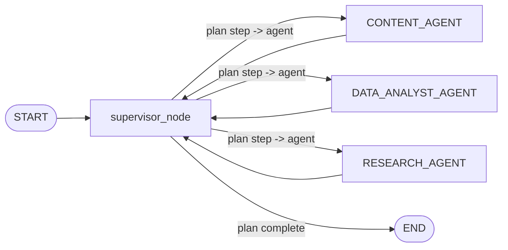

# System Specification: SnowLangGraph Multi-Agent Customer Intelligence

**Status:** Active (Trial-Compatible Mode Live; Production Mode Defined)  
**Entrypoint:** `langgraph.json` → `./studio_app.py:app` (`supervisor_workflow`; code in `supervisor.py`, `snowflake_client.py`, `observability.py`)  
**Target Warehouse & Schema:** `SNOWFLAKE_LEARNING_WH`, `CUSTOMER_INTELLIGENCE_DB.PUBLIC`, `SNOWFLAKE_INTELLIGENCE.AGENTS`

---

## 1. Purpose & Scope

SnowLangGraph answers cross-domain customer intelligence questions (support feedback, product usage, churn risk, and MRR/industry strategy) using a **LangGraph hub-and-spoke supervisor** over **Snowflake** data and **Cortex Analyst Semantic Views**.

The system supports two runtime modes controlled by `SNOWFLAKE_USE_CORTEX_AGENTS` in `.env`:
1. **Trial-Compatible Mode (`false`, default):** Uses live Snowflake **Cortex Analyst REST API** (`/api/v2/cortex/analyst/message`) + parameterized Snowflake SQL + local deterministic planning/synthesis, avoiding endpoints restricted on unpaid Snowflake trial accounts.
2. **Managed Cortex Agents Mode (`true`):** Delegates worker execution to Snowflake-managed `SnowflakeCortexAgent` instances (planning and synthesis stay deterministic Python in both modes) (`CONTENT_AGENT`, `DATA_ANALYST_AGENT`, `RESEARCH_AGENT`).

---

## 2. Graph Architecture & State Contract

### 2.1 Architectural Invariants
- **Plan Once Per Question:** `supervisor_node` builds `plan` once per user question (`planning_complete=True`) and does not mutate it during execution. A new `HumanMessage` in the same thread (`is_new_turn()`) triggers a fresh plan, so old plans and outputs are never reused.
- **No LLM Re-Routing Overhead:** `supervisor_node` advances deterministically by reading `plan["steps"][current_step]`.
- **Non-Cascading Errors:** Agent exceptions are captured in `State.execution_errors` and returned cleanly to `supervisor_node` so remaining steps and synthesis still complete.
- **Concurrent-Run Safety:** The Snowpark `Session` is shared but created lazily (`get_session()`, thread-safe). The QUERY_TAG is sent with each statement (`collect(statement_params={"QUERY_TAG": ...})`). The code never changes `session.query_tag`, so runs at the same time cannot mix tags (tested with two threads). `evaluate_observability.py` still uses `max_concurrency=1` to keep the demo output readable.

### 2.2 State Schema (`State(MessagesState)` in `supervisor.py`)
| Field | Type | Default | Contract |
| --- | --- | --- | --- |
| `messages` | `List[BaseMessage]` | `[]` | User `HumanMessage`, per-agent `AIMessage(name=...)`, final `supervisor` `AIMessage` |
| `plan` | `Optional[Dict]` | `None` | `{"plan_summary": str, "total_steps": int, "steps": List[Dict]}` |
| `current_step` | `int` | `0` | Index into `plan["steps"]`; incremented by `_execute_agent_step()` |
| `agent_outputs` | `Dict` | `{}` | Map of `AGENT_NAME` → markdown string output |
| `execution_errors` | `List` | `[]` | Collected error messages (`"<AGENT_NAME> error: <exc>"`) |
| `planning_complete` | `bool` | `False` | `True` once initial plan is created |
| `query_ids` | `List[str]` | `[]` | Ordered Snowflake `sfqid` values collected via `AsyncJob.query_id` |
| `sql_metrics` | `List[Dict[str, Any]]` | `[]` | Per-query telemetry (`agent`, `tool`, `sfqid`, `cortex_request_id`, `analyst_ms`, `sql_ms`, `rows`) |

---

## 3. Agent & Routing Specifications

### 3.1 `supervisor_node` (`supervisor.py`)
1. **Mode 1 — Planning (`not has_plan(state)`):**
   - Extracts latest user prompt via `get_latest_human_message(messages)`. If empty, terminates (`goto="__end__"`).
   - `_build_trial_plan(query)` inspects the lowercased prompt. A term matches only at the start of a word (`api` matches "APIs", not "rapid"):
     - **`CONTENT_AGENT`** triggers: `("ticket", "feedback", "complain", "sentiment", "support", "issue", "bug", "api")`
     - **`DATA_ANALYST_AGENT`** triggers: `("churn", "usage", "session", "engagement", "behavior", "plan", "active", "cust_")`
     - **`RESEARCH_AGENT`** triggers: `("industr", "market", "lifetime", "clv", "ltv", "mrr", "revenue", "segment", "strategic")`
     - **Default fallback:** If none match, routes 1 step to `DATA_ANALYST_AGENT`.
   - Sets `uses_data_from` so `DATA_ANALYST_AGENT` receives step 1 output when `CONTENT_AGENT` ran, and `RESEARCH_AGENT` receives all prior step outputs.
   - Annotates active LangSmith span with `plan_summary`, `total_steps`, `route`, and tags (`trial_mode` or `cortex_agents_mode`, `route:<agents>`).
2. **Mode 2 — Routing (`not is_plan_complete(state)`):**
   - Returns `Command(goto=current_step["agent"])` if valid in `AGENT_NAMES`.
3. **Mode 3 — Synthesis:**
   - `_synthesize_trial_response()` combines `Summary`, per-agent sections, `Execution Notes` (if errors), and `Observability Telemetry` (`LangSmith Trace ID`, query count, total SQL ms, `sfqid`s, and `AGENT_OBSERVABILITY_LOGS` lookup SQL).
   - Emits online feedback via `emit_langsmith_feedback()`.

### 3.2 `CONTENT_AGENT`
- **Trial Mode (`run_content_sql_search`):**
  - Extracts `CUST_\d+` IDs or up to `5` non-stopword keywords (`_STOPWORDS`).
  - Uses parameterized `?` bindings (`session.sql(..., params=...)`)—never raw string interpolation—against `CUSTOMER_INTELLIGENCE_DB.PUBLIC.SUPPORT_TICKETS`.
  - Executes 3 queries: `SUPPORT_TICKETS_SUMMARY` (falls back to unfiltered `SUPPORT_TICKETS_SUMMARY_FALLBACK` if keyword filter returns `0`), `SUPPORT_TICKETS_BREAKDOWN` (top 8 categories), and `SUPPORT_TICKETS_SAMPLES` (latest 8 excerpts + affected `CUST_*` IDs).
- **Managed Mode (`sql/05_setup_cortex_agents.sql`):** `SNOWFLAKE_INTELLIGENCE.AGENTS.CONTENT_AGENT` (`claude-4-sonnet` orchestration, `SUPPORT_TICKETS_SEARCH` + `CUSTOMER_CONTENT_ANALYZER`).

### 3.3 `DATA_ANALYST_AGENT`
- **Trial Mode (`run_cortex_analyst`):** POSTs user query to `https://<host>/api/v2/cortex/analyst/message` with `semantic_view = CUSTOMER_INTELLIGENCE_DB.PUBLIC.CUSTOMER_BEHAVIOR_ANALYST`, captures `request_id` (`cortex_request_id`), executes returned `sql` block via `execute_snowflake_sql()`, and formats up to `12` rows in markdown.
- **Managed Mode:** `SNOWFLAKE_INTELLIGENCE.AGENTS.DATA_ANALYST_AGENT` (`CUSTOMER_BEHAVIOR_ANALYST` + `CUSTOMER_BEHAVIOR_ANALYZER`).

### 3.4 `RESEARCH_AGENT`
- **Trial Mode (`run_cortex_analyst`):** Same Cortex Analyst REST flow targeting `CUSTOMER_INTELLIGENCE_DB.PUBLIC.STRATEGIC_RESEARCH_ANALYST`.
- **Managed Mode:** `SNOWFLAKE_INTELLIGENCE.AGENTS.RESEARCH_AGENT` (`STRATEGIC_RESEARCH_ANALYST` + `CUSTOMER_SEGMENT_INTELLIGENCE`).

---

## 4. Data & Snowflake DDL Specification

| Object | Type | Source File | Verified State |
| --- | --- | --- | --- |
| `CUSTOMER_INTELLIGENCE_DB.PUBLIC.CUSTOMERS` | Table | `sql/01_setup_database_and_load_data.sql` | `10,000` rows |
| `CUSTOMER_INTELLIGENCE_DB.PUBLIC.USAGE_EVENTS` | Table | `sql/01_setup_database_and_load_data.sql` | `508,637` rows (`9,990` customers; backfilled from `101,711`) |
| `CUSTOMER_INTELLIGENCE_DB.PUBLIC.SUPPORT_TICKETS` | Table | `sql/01_setup_database_and_load_data.sql` | `8,954` rows |
| `CUSTOMER_INTELLIGENCE_DB.PUBLIC.CHURN_EVENTS` | Table | `sql/01_setup_database_and_load_data.sql` | `703` rows |
| `CUSTOMER_BEHAVIOR_ANALYST` | Semantic View | `sql/03_setup_semantic_views.sql` | Active |
| `STRATEGIC_RESEARCH_ANALYST` | Semantic View | `sql/03_setup_semantic_views.sql` | Active |
| `AGENT_OBSERVABILITY_LOGS` | View | `sql/06_setup_observability_view.sql` | Active (`RESULT_LIMIT => 10000`, `EXECUTION_STATUS != 'RUNNING'`) |
| `SNOWFLAKE_INTELLIGENCE.AGENTS.*` | Agents DDL | `sql/05_setup_cortex_agents.sql` | DDL created (`CONTENT_AGENT`, `DATA_ANALYST_AGENT`, `RESEARCH_AGENT`) |
| `SUPPORT_TICKETS_SEARCH`, `CUSTOMERS_SEARCH` | Cortex Search | `sql/02_setup_cortex_search.sql` | Blocked on unpaid trial (`399258`) |
| `AI_ANALYZE_CUSTOMER_*`, `AI_PREDICT_CHURN_RISK` | SQL UDFs | `sql/04_setup_udfs.sql` | Blocked on unpaid trial (`399258`) |

### SQL Alignment (fixed, partly untested)
`sql/05_setup_cortex_agents.sql` now points its three custom tools at the SQL functions that `sql/04_setup_udfs.sql` creates (`type: "function"`; `AI_ANALYZE_CUSTOMER_CONTENT`, `AI_PREDICT_CHURN_RISK`, `AI_ANALYZE_CUSTOMER_SEGMENT`). The `DATA_ANALYST_AGENT` tool takes `analysis_days` (integer), matching `AI_PREDICT_CHURN_RISK`. The agent DDL is applied in Snowflake. The functions cannot be created on the unpaid trial (`399258`), so managed mode is untested end to end. The function logic was checked with a temporary stand-in for `AI_COMPLETE`.

`sql/04` counts `high` and `urgent` tickets (the data has no `critical` priority) and measures date windows back from the newest row in the data, not from `CURRENT_DATE()` (the data ends on 2024-10-01).

---

## 5. Authentication, Runtime & Trial Constraints

- **Snowflake Auth:** `_create_snowflake_session()` uses `SNOWFLAKE_AUTHENTICATOR` (if set) via `Session.builder.configs(...)`, otherwise `create_session_from_env()` (`SNOWFLAKE_ACCOUNT`, `SNOWFLAKE_USER`, `SNOWFLAKE_PASSWORD`).
  - *PAT constraint:* Snowflake rejects PATs with `250001` unless a network policy is attached to the user/account.
  - *`externalbrowser` constraint:* Fails with `390190` unless a SAML Identity Provider is configured on the Snowflake account.
- **Pinned Runtime Dependencies (`.venv`, Python `3.12.4`):**
  - `sqlalchemy<2.1` (`2.0.57`) required for `snowflake-sqlalchemy==1.11.1` / `trulens-connectors-snowflake`.
  - `cryptography<47` (`46.0.0`) required for `pyOpenSSL==25.3.0` / `snowflake-connector-python==3.18.1` alongside `langgraph-api==0.13.3`.
  - `langgraph dev` MUST be started with `--allow-blocking` because Snowpark and `requests` calls are synchronous.
- **Unpaid Trial Restrictions Observed:**
  - `399258`: `AI_COMPLETE`, `AI_EMBED`, `EMBED_TEXT_768`, `EMBED_TEXT_1024` disabled on trial accounts.
  - `399270`: Legacy `SNOWFLAKE.CORTEX.COMPLETE` blocked on new accounts (`ChatSnowflake` default `_use_rest_api=False`).
  - `403 Forbidden`: `/api/v2/cortex/inference:complete` blocked on trial accounts.
  - `399504`: `/api/v2/databases/.../agents/...:run` returns `Access denied for trial accounts.`

---

## 6. Observability & Evaluation Requirements

Full storage schemas and field mappings are defined in `OBSERVABILITY_DATA_MODEL.md`.

### 6.1 Online Tracing & Feedback (`observability.py`, `snowflake_client.py`, `supervisor.py`)
- Feedback is attached to the root run (`trace_id` equals the root run id), not to the supervisor span.
- Nested LangSmith `@traceable` spans: `cortex_analyst_text_to_sql` (`llm`), `snowflake_support_tickets_search` (`retriever`), `snowflake_sql_execute` (`tool`).
- Every SQL execution captures `sfqid` via `df.collect(block=False).query_id` and sends a structured JSON QUERY_TAG with the statement (`app`, `trace_id`, `agent`, `step`, `tool`).
- Synthesis emits deterministic LangSmith feedback: `execution_success`, `non_empty_results`, `zero_errors`, `step_count`.

### 6.2 Offline Evaluation Suite (`evaluate_observability.py`)
1. **LangSmith Dataset (`SnowLangGraph Customer Intelligence Eval`, `4` examples):** Evaluates `eval_route_match`, `eval_sql_executed`, and `eval_zero_errors` (feedback keys `route_match`, `sql_executed_with_rows`, `eval_zero_errors`) at `max_concurrency=1`.
2. **TruLens OTEL Recording (`TruGraph` + `TruSession`):** Captures `SPAN` events into `default.sqlite` (`trulens_events`, `trulens_apps`). *(Cortex LLM judges in `build_and_evaluate_agents_with_langgraph_and_snowflake.ipynb`—`Plan Quality`, `Plan Adherence`, `Execution Efficiency`, `Logical Consistency`—require a Cortex-enabled account or external judge provider.)*
3. **Snowflake Audit Verification:** Queries `CUSTOMER_INTELLIGENCE_DB.PUBLIC.AGENT_OBSERVABILITY_LOGS` to verify `LANGSMITH_TRACE_ID` ↔ `QUERY_ID` correlation.

---

## 7. Acceptance Criteria

1. **CLI Execution:** `.venv/bin/python studio_app.py` exits `0`, produces valid Cortex Analyst SQL + live Snowflake rows, and prints `Observability Telemetry` with `sfqid`s.
2. **Dev Server & Studio API:** `.venv/bin/langgraph dev --allow-blocking --no-browser` returns `{"ok":true}` on `GET /ok`, registers `supervisor_workflow` on `POST /assistants/search`, and completes `POST /runs/wait` with `LangSmith Trace ID` correlation.
3. **Eval Suite:** `.venv/bin/python evaluate_observability.py` completes all `4` LangSmith examples, writes `>=1` TruLens record to `default.sqlite`, and retrieves correlated rows from `AGENT_OBSERVABILITY_LOGS`.
4. **Static / Graph Checks:** `uv pip check --python .venv/bin/python` reports zero incompatibilities; `gitnexus check --cycles` reports `No circular imports found.`
